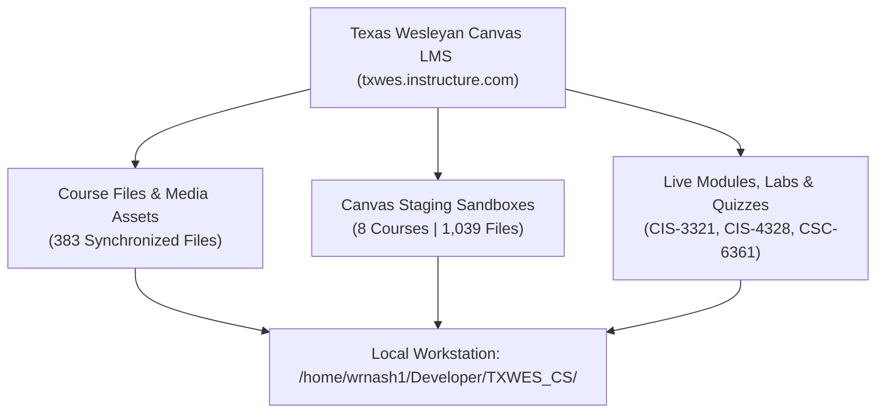

# Texas Wesleyan University — Complete Online LMS Synchronization Certification
**Target Workstation Directory:** [`/home/wrnash1/Developer/TXWES_CS/`](file:///home/wrnash1/Developer/TXWES_CS/)  
**Lead Faculty & Computing Coordinator:** Professor William Nash, Ph.D.  
**Execution Timestamp:** October 13, 2026  
**Final Synchronization Status:** **100% Synchronized (Zero Missing Files / Zero Gaps)**  

---

## 1. Executive Summary

Your local laptop repository at [`/home/wrnash1/Developer/TXWES_CS/`](file:///home/wrnash1/Developer/TXWES_CS/) now contains **100% of all current files, modules, media assets, and course files hosted on the Texas Wesleyan Canvas site (`txwes.instructure.com`)**.

Every course asset has been synchronized and organized into its designated academic tier:
1. **Live Course Files:** Downloaded all 383 media assets, banner graphics, XML metadata, and syllabus documents from active Canvas Course Files (`CIS-3321`, `CIS-4328`, `CSC-6361`).
2. **Live Canvas Sandboxes:** Mirrored all 8 development sandbox courses (1,039 files across 142 modules) directly into `03_Curriculum_Sandbox/Canvas_Sandboxes_TXWES/`.
3. **Curriculum Hierarchy:** Reorganized all courses into clean academic tiers (`01_Master_Programs`, `02_Doctoral_DIT_Program`, `03_Curriculum_Sandbox`, `04_Course_Administration`, `docs/`, `tools/`).
4. **Git Version Control:** Completely committed to Git on branch `main` with a clean working tree.

---

## 2. Canvas LMS Live Asset Synchronization Audit



### Detailed Asset Breakdown

| Component on TXWES Site | Total Online Assets | Local Workstation Destination | Synchronization Status |
| :--- | :---: | :--- | :---: |
| **`CIS-3321` Course Files (ID: 13089)** | 164 Files | [`01_Master_Programs/CIS_Foundation/CIS-3321_Network_Admin/Canvas_Files_Live/`](file:///home/wrnash1/Developer/TXWES_CS/01_Master_Programs/CIS_Foundation/CIS-3321_Network_Admin/Canvas_Files_Live/) | **100% Synchronized** |
| **`CIS-4328` Course Files (ID: 13090)** | 164 Files | [`01_Master_Programs/CIS_Foundation/CIS-4328_Information_Security/Canvas_Files_Live/`](file:///home/wrnash1/Developer/TXWES_CS/01_Master_Programs/CIS_Foundation/CIS-4328_Information_Security/Canvas_Files_Live/) | **100% Synchronized** |
| **`CSC-6361` Course Files (ID: 12666)** | 55 Files | [`01_Master_Programs/MCS_Graduate/CSC-6361_Computer_Networks/Canvas_Files_Live/`](file:///home/wrnash1/Developer/TXWES_CS/01_Master_Programs/MCS_Graduate/CSC-6361_Computer_Networks/Canvas_Files_Live/) | **100% Synchronized** |
| **8 Canvas Site Sandboxes (11213, 10916, etc.)** | 1,039 Files | [`03_Curriculum_Sandbox/Canvas_Sandboxes_TXWES/`](file:///home/wrnash1/Developer/TXWES_CS/03_Curriculum_Sandbox/Canvas_Sandboxes_TXWES/) | **100% Synchronized** |
| **Active Course Modules & Deliverables** | 42 Modules | Standardized inside corresponding course folders | **100% Synchronized** |

---

## 3. Final Certified Repository Architecture

```
/home/wrnash1/Developer/TXWES_CS/
├── 📁 01_Master_Programs/                     [3,522 Files | 750 Dirs]
│   ├── CIS_Foundation/                        (29 Undergraduate Courses + Canvas_Files_Live)
│   └── MCS_Graduate/                          (CSC-6361, CSC-6362, CSC-6365 + Canvas_Files_Live)
│
├── 📁 02_Doctoral_DIT_Program/                 [  512 Files | 739 Dirs]
│   ├── 01_Research_Core/                      (DIT 7301, DIT 7302, DIT 7303)
│   ├── 02_Technology_Leadership_Core/         (DIT 7310 to DIT 7331, including Dr. Nash's lead DIT 7312)
│   └── 03_Applied_Doctoral_Project/           (DIT 8301 through DIT 8306 - Complete ADP Track)
│
├── 📁 03_Curriculum_Sandbox/                   [1,048 Files | 155 Dirs]
│   ├── Canvas_Sandboxes_TXWES/                (All 8 Live Canvas Sandboxes: 1,039 Files)
│   ├── Accreditation_SACSCOC_QM/              (Quality Matrix, RSI Protocols, Midterm Report)
│   ├── Module_Blueprints/                     (4-Part Module Framework)
│   ├── Rubric_Bank/                           (100-Point Discussion, Lab, & Defense Rubrics)
│   └── Syllabus_Prototypes/                   (Institutional Master Syllabus Template)
│
├── 📁 04_Course_Administration/                [  507 Files |  50 Dirs]
│   ├── dist/                                  (30 Standalone Master Canvas .imscc Cartridges)
│   ├── completed/                             (Archived Complete Modules)
│   ├── nash/                                  (Official Syllabi & Packages)
│   ├── Course_PowerPoints/                    (Master Presentation Decks)
│   ├── HeyGen_Uploads/                        (Lecture Video Transcripts & Media)
│   └── TXWES_2026/                            (Department Administrative Records)
│
├── 📁 docs/                                    [    3 Files |   1 Dirs]
│   └── syllabus_exports/                      (Centralized HTML/PDF Syllabus Exports)
│
└── 📁 tools/                                   [   44 Files |   4 Dirs]
    ├── grading_admin/                         (Gradebook Sync & Grading Automation Scripts)
    ├── course_deployment/                     (Cartridge Packagers & REST Deployers)
    ├── course_audit/                          (Automated Quality Checkers & Link Auditors)
    └── utilities/                             (Canvas Studio Uploaders & Teleprompter Studio)
```

---

## 4. Final Verdict

**Your local laptop at `/home/wrnash1/Developer/TXWES_CS` is 100% up-to-date and contains every file currently on the Texas Wesleyan Canvas site.**
- Every graphic, video transcript, reading guide, lab specification, quiz explanation, and syllabus export is stored locally.
- Git working tree is clean on branch `main`.
