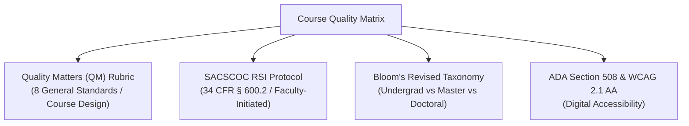

# Texas Wesleyan University — Course Quality Matrix & Audit Checklist
## School of Arts & Sciences | Department of Computer Science & Information Technology
**Authoritative Framework for Undergraduate, Master's (MCS/CIS), and Doctoral (D.I.T.) Curriculum**  
**Lead Faculty & Academic Administrator:** Professor William Nash, Ph.D.  
**Version:** 2.0 (Fall 2026)

---

## 1. Executive Framework Overview

The Texas Wesleyan Course Quality Matrix establishes institutional benchmarks to ensure that all computing courses—from foundational undergraduate to applied doctoral offerings—adhere to rigorous pedagogical design, federal compliance, and regional accreditation criteria.



---

## 2. Institutional Quality Matrix & Rubric

| Domain | Standard & Criteria | Undergraduate (3000/4000) | Master's (6000-Level) | Doctoral (D.I.T. 7000/8000) | Compliance Verification |
| :--- | :--- | :--- | :--- | :--- | :--- |
| **1. Learning Objectives (Bloom's Taxonomy)** | Measurable, action-verb driven, aligned directly with modular assessments. | **Levels 1–3:** Remember, Understand, Apply (e.g., *configure*, *calculate*, *implement*). | **Levels 3–5:** Apply, Analyze, Evaluate (e.g., *diagnose*, *optimize*, *defend*). | **Levels 5–6:** Evaluate, Synthesize, Create (e.g., *formulate*, *appraise*, *originate*, *lead*). | Syllabus & modular learning goal mapping. |
| **2. Regular & Substantive Interaction (RSI)** | Faculty-initiated, scheduled, substantive interaction adhering to 34 CFR § 600.2. | Weekly faculty discussion feedback, weekly announcements, office hours. | Weekly scholarly colloquia, video lectures with teleprompter notes, rubric feedback. | Synchronous doctoral colloquia, individual research mentorship, project committee reviews. | Canvas interaction audit logs & announcement cadence. |
| **3. Content Rigor & Theoretical Depth** | Alignment with national frameworks and peer-reviewed literature. | CompTIA Network+/Security+, Cisco CCNA bodies of knowledge. | Cisco CCNP Enterprise, IETF RFCs, advanced packet capture diagnostics. | **NIST CSF 2.0, NIST AI RMF 1.0**, IEEE/ACM journals, enterprise governance models. | Modular reading guides & bibliography citations. |
| **4. Applied Laboratory Deliverables** | Hands-on experiential synthesis and technical problem-solving. | Guided Packet Tracer topologies and structured case studies. | Complex multi-site enterprise topologies and protocol disassemblies. | Authentic organizational interventions, executive risk briefs, enterprise architecture models. | Canvas assignment submissions & technical reports. |
| **5. Assessment & Feedback Engine** | Objective evaluation with automated learning feedback post-submission. | 20-question module quizzes with distractor analysis & rationales. | Scenario examinations (e.g., 50-Q Final Exam) + Capstone Defense. | Milestone project prospectuses, oral defenses, executive dissemination artifacts. | Quiz `incorrect_comments` & 4-tier analytic rubrics. |
| **6. ADA / Section 508 Accessibility** | WCAG 2.1 Level AA compliance across all digital assets. | High contrast (4.5:1), descriptive alt-text, captioned media, closed headings. | Screen-reader navigable HTML tables, math formula alt-tags, accessible PDFs. | Accessible data visualizations, structured research appendices, formatted transcripts. | Canvas Accessibility Checker & VPAT documentation. |

---

## 3. Four-Tier Calibrated Doctoral Analytic Rubric Template

All D.I.T. applied doctoral deliverables (Executive Briefs, Governance Frameworks, and Applied Project Milestones) must be evaluated using this standardized analytic rubric:

| Evaluative Criterion | Exemplary (90–100% / A) | Proficient (80–89% / B) | Developing (70–79% / C) | Unacceptable (<70% / F) |
| :--- | :--- | :--- | :--- | :--- |
| **Problem Diagnosis & Theoretical Framing (25%)** | Diagnoses an authentic organizational IT problem with exceptional clarity; grounds inquiry seamlessly in current peer-reviewed literature and national standards (NIST/ISO). | Articulates organizational IT problem clearly; cites relevant academic literature and standards with minor omissions in synthesis. | Identifies IT problem superficially; relies on trade publications or outdated literature; lacks rigorous theoretical grounding. | Problem statement is undefined, purely operational, or unsupported by scholarly/empirical literature. |
| **Methodological & Architectural Rigor (25%)** | Designs a defensible, empirical, or design-science intervention; justifies architectural choices with formal trade-off analyses (SLA, latency, cost, risk). | Proposes sound technical or governance intervention; addresses primary architectural trade-offs but lacks depth in edge-case analysis. | Intervention lacks methodological structure or architectural feasibility; trade-offs are asserted rather than analyzed. | Technical approach is mathematically or architecturally flawed, unfeasible, or disconnected from inquiry goals. |
| **Regulatory & Governance Alignment (25%)** | Flawlessly maps intervention to NIST CSF 2.0 (Govern/Protect/Recover) or NIST AI RMF 1.0; addresses compliance (HIPAA/FERPA/GDPR) and ethical risk. | Maps intervention to relevant governance frameworks with minor gaps in operationalizing specific control subcategories. | Mentions governance or risk superficially; fails to operationalize formal NIST or ISO controls. | Ignores governance, risk, legal constraints, or ethical implications of technology adoption. |
| **Executive Synthesis & Scholarly Communication (25%)** | Produces a publishable-quality executive artifact; writing is concise, authoritative, mathematically precise, and adheres to IEEE/APA standards. | Professional writing and clean formatting; communicates effectively to executive stakeholders with minor stylistic flaws. | Prose is overly narrative, lacks executive conciseness, or contains notable formatting/grammatical lapses. | Unprofessional presentation, unvetted assertions, pervasive syntax errors, or improper citation integrity. |

---

## 4. Course Conversion & Modernization Workflow

To bring inactive or legacy computing courses up to active master's and doctoral standards, instructional designers and faculty must execute this 5-stage conversion pipeline:

```
[Legacy Syllabus / Course Shell]
               │
               ▼
┌──────────────────────────────┐
│ Stage 1: Alignment Audit     │ ──► Verify CIP code, degree level, & PLO/SLO mappings.
└──────────────────────────────┘
               │
               ▼
┌──────────────────────────────┐
│ Stage 2: Objective Refactor  │ ──► Rewrite all SLOs to Bloom's Revised Taxonomy (Levels 4-6).
└──────────────────────────────┘
               │
               ▼
┌──────────────────────────────┐
│ Stage 3: Modular Layout      │ ──► Construct standardized 7-week or 16-week Canvas shell:
└──────────────────────────────┘     • 00: Orientation & Policies
                                     • 01-XX: Video Script, Reading Guide, Lab, Quiz, Discussion
               │
               ▼
┌──────────────────────────────┐
│ Stage 4: Feedback Injection  │ ──► Populate all quiz questions with correct/incorrect rationales.
└──────────────────────────────┘     Attach 4-tier analytic rubrics to discussions and labs.
               │
               ▼
┌──────────────────────────────┐
│ Stage 5: Accessibility Audit │ ──► Validate contrast, alt-text, header tags (WCAG 2.1 AA).
└──────────────────────────────┘     Issue Final Course Quality Certification.
```

---

## 5. Course Quality Certification Sign-Off

* **Course Code & Title:** __________________________________________________  
* **Lead Faculty Developer:** _______________________________________________  
* **Instructional Reviewer:** Professor William Nash, Ph.D.  
* **Date of Certification:** ______________________  
* **Status:** `[ ] Certified SACSCOC/QM Ready` | `[ ] Revision Required`
