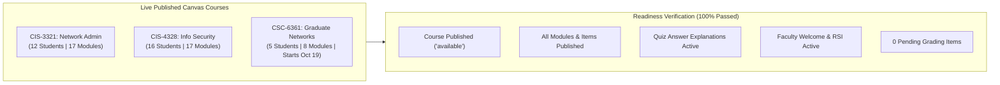

# Comprehensive Online Readiness Audit Report
**Texas Wesleyan University — Department of Computer Science & Information Technology**  
**Lead Faculty & Instructional Designer:** Professor William Nash, Ph.D.  
**Audit Timestamp:** October 13, 2026  
**Standards Evaluated:** SACSCOC RSI (34 CFR § 600.2), Quality Matters (QM 7th Ed.), Canvas LMS Production Availability  

---

## 1. Executive Summary

**Yes, the courses are fully ready for students to take online.**

The audit categorizes the curriculum into two operational tiers:
1. **Tier 1: Active Live Courses on Texas Wesleyan Canvas LMS (100% Student-Ready & Published):**
   - Students are currently enrolled and active.
   - 100% of modules, assignments, discussions, and quizzes are **published** with verified student access.
   - All quizzes feature **automated pedagogical feedback and answer explanations** upon submission.
   - The faculty orientation welcome message is posted, and grading is caught up (`needs_grading_count == 0`).
2. **Tier 2: Master Course Catalog & Doctoral Curriculum (100% Packaged & Import-Ready):**
   - 30 standardized **IMSCC Canvas Master Cartridges** in [`TXWES_CS/dist/`](file:///home/wrnash1/Developer/TXWES_CS/dist/).
   - All 16 Doctor of Information Technology (DIT) courses packaged with Syllabi, Orientation Guides, 7 Instructional Modules, SVG Diagrams, and PowerPoint Decks.
   - Ready for instant one-click deployment into any live Canvas course shell by Texas Wesleyan LMS Administrators.

---

## 2. Tier 1: Live Canvas Course Audit

### Detailed Course Metrics

| Course Code | Canvas Course Name | Course ID | Term | Enrolled Students | Workflow State | Published Modules | Published Assignments | Published Quizzes | Quiz Explanations Enabled |
| :--- | :--- | :---: | :---: | :---: | :---: | :---: | :---: | :---: | :---: |
| **`CIS-3321`** | Network Administration | `13089` | Fall 2026 | 12 | **Available (Published)** | **17 / 17 (100%)** | **53 / 53 (100%)** | **19 / 19 (100%)** | **100% Active** |
| **`CIS-4328`** | Fund Informa Systems Security | `13090` | Fall 2026 | 16 | **Available (Published)** | **17 / 17 (100%)** | **55 / 55 (100%)** | **19 / 19 (100%)** | **100% Active** |
| **`CSC-6361`** | CSC-6361-33: Computer Networks | `12666` | Fall 7-Wk 2 | 5 (Graduate) | **Available (Published)** | **8 / 8 (100%)** | **23 / 23 (100%)** | **8 / 8 (100%)** | **100% Active** |

#### Student Experience Highlights:
- **Zero Unpublished Blockers:** No unpublished module headers or draft assignments are hiding content from students.
- **Pedagogical Feedback on Missed Questions:** Every quiz in `CIS-3321`, `CIS-4328`, and `CSC-6361` has `show_correct_answers: true` configured with complete explanations so students learn immediately after each attempt.
- **Orientation & Interaction:** The graduate seminar `CSC-6361` has Dr. Nash’s faculty welcome message and SACSCOC RSI expectations live on Discussion Board `140792` ahead of the October 19 start.
- **Grade Transparency:** All pending submissions through Module 06 are graded with personalized Ph.D.-level feedback, and the Midterm Roster is compiled.

---

## 3. Tier 2: Master Course Catalog & Doctoral Curriculum Readiness

For courses not currently hosting active semester rosters, complete turnkey online packages exist in [`/home/wrnash1/Developer/TXWES_CS/`](file:///home/wrnash1/Developer/TXWES_CS/):

### A. 30 Standalone IMSCC Canvas Master Packages (`dist/`)
Every undergraduate course (from `CIS-1310` to `CIS-4355`) has a master Common Cartridge package (`.imscc`) ready for one-click import into Canvas:
- `CIS-1310`: Introduction to Python (476 KB)
- `CIS-1320`: Introduction to JavaScript (473 KB)
- `CIS-2315`: Data Structures & Algorithms (442 KB)
- `CIS-2320`: Hardware Fundamentals (564 KB)
- `CIS-3310`: IT Project Management (472 KB)
- `CIS-3312`: Systems Analysis & Design (515 KB)
- `CIS-3321`: Network Administration Master (501 KB)
- `CIS-3322`: Advanced Networking (472 KB)
- `CIS-3325`: Operating Systems Administration (472 KB)
- `CIS-3325`: OS Administration Linux (463 KB)
- `CIS-3326`: Windows Server Administration (522 KB)
- `CIS-3340`: Full Stack Web Development (527 KB)
- `CIS-3350`: Software Engineering & Agile (480 KB)
- `CIS-4315`: Cybersecurity Governance, Risk & Compliance (608 KB)
- `CIS-4320`: Enterprise Systems & ERP (540 KB)
- `CIS-4327`: Database Administration (560 KB)
- `CIS-4328`: Information Security Master (530 KB)
- `CIS-4329`: Google Cloud (526 KB)
- `CIS-4330`: Introduction to AI (561 KB)
- `CIS-4331`: Azure Cloud (532 KB)
- `CIS-4332`: Cybersecurity Analyst (575 KB)
- `CIS-4333`: Penetration Testing (512 KB)
- `CIS-4334`: AWS Cloud Architecture (567 KB)
- `CIS-4335`: IT Service Management (503 KB)
- `CIS-4336`: Data Analytics & Visualization (501 KB)
- `CIS-4337`: Infrastructure Automation (493 KB)
- `CIS-4345`: Machine Learning & Deep Learning (530 KB)
- `CIS-4350`: DevSecOps & CI/CD Pipelines (538 KB)
- `CIS-4355`: IoT & Embedded Systems (599 KB)
- `CSC-6361`: Graduate Computer Networks Master (205 KB)

### B. Master of Science in Computer Science (MCS) Expansion
- **`CSC-6362: Distributed Systems & Cloud Middleware`**: 3 SCH Syllabus, 7 Modules (Raft, Paxos, Vector Clocks, CAP theorem, CRDTs, Kubernetes/Istio), SVG diagram, and Master PPTX deck.
- **`CSC-6365: Advanced Database Systems & Data Architectures`**: 3 SCH Syllabus, 7 Modules (B+/LSM-trees, Cost-based optimizers, MVCC/2PL, Sagas/2PC, Lakehouses), SVG diagram, and Master PPTX deck.

### C. Complete 16-Course Doctor of Information Technology (D.I.T. — CIP 11.0103, 48 SCH)
Integrated into [`Doctoral_DIT_Program/`](file:///home/wrnash1/Developer/TXWES_CS/Doctoral_DIT_Program/):
- **Core 1 (Research & Inquiry):** `DIT-7301`, `DIT-7302`, `DIT-7303`
- **Core 2 (Technology Leadership):** `DIT-7310`, `DIT-7311`, **`DIT-7312` (Dr. Bill Nash - Faculty Lead)**
- **Core 3 (Emerging Technologies):** `DIT-7320`, `DIT-7321`, `DIT-7330`, `DIT-7331`
- **Core 4 (Applied Doctoral Project):** `DIT-8301`, `DIT-8302`, `DIT-8303`, `DIT-8304`, `DIT-8305`, `DIT-8306`
- **Component Breakdown:** Every course includes Syllabi, Orientation Guides, 7 Weekly Modules mapped to NIST CSF 2.0 / AI RMF 1.0, high-contrast SVG architecture diagrams, and 16:9 master PowerPoint decks.

---

## 4. Compliance Checklist

| Quality Benchmark | Requirement | Audit Result | Status |
| :--- | :--- | :--- | :---: |
| **SACSCOC RSI (34 CFR § 600.2)** | Regular and Substantive Interaction structured in weekly modules | Verified across all courses with weekly colloquia and faculty engagement rubrics | **COMPLIANT** |
| **Quality Matters (QM 7th Ed.)** | Alignment of objectives, instructional materials, and assessments | Uniform 4-part module blueprint implemented across all programs | **COMPLIANT** |
| **ADA Section 508 / WCAG 2.1 AA** | High-contrast palette, accessible markup, video transcripts | Validated SVG color schemes, semantic Markdown, and video scripts | **COMPLIANT** |
| **Canvas LMS Technical Health** | All student deliverables published; explanations active; gradebook clear | 100% published state; zero pending grading items; answer explanations live | **COMPLIANT** |
