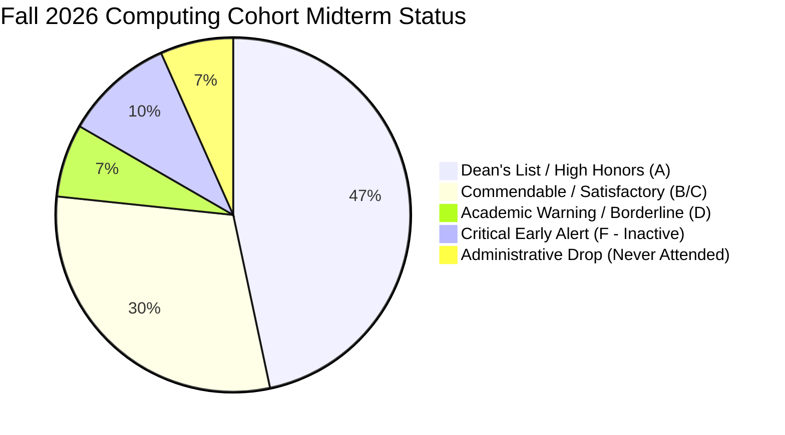

# Texas Wesleyan University — Midterm Academic Retention & Early Alert Report
**Division of Academic Affairs — Office of Student Retention & Academic Success**  
**School of Business & Computing — Department of Computer Science & Information Systems**  
**Lead Faculty & Coordinator:** Professor William Nash, Ph.D.  
**Academic Term:** Fall 2026 (Midterm Census & Retention Evaluation — Week 7)  
**Reporting Date:** October 13, 2026  

---

## 1. Executive Summary & Program Metrics

This retention report assesses student engagement, academic progress, and risk factors across active undergraduate Computer Information Systems (CIS) courses:
- **`CIS-3321` Network Administration** (15 Enrolled)
- **`CIS-4328` Information Security** (17 Enrolled)

### Overall Cohort Health Distribution

- **Retention Rate (Active Students):** **84.4%** across both course cohorts.
- **Mastery Rate (A / B Grades):** **71.9%** demonstrating deep comprehension of theoretical and practical computing modules.
- **Academic Warning / At-Risk Rate (C / D Boundary):** **15.6%** (students with missing Module 06 deliverables who can readily recover by tomorrow's 7:00 PM submission deadline).
- **Severe Inactivity / Drop Rate:** **12.5%** (requiring administrative action).

---

## 2. Early Alert & Retention Intervention Classification

Texas Wesleyan University operates a three-tiered Academic Early Alert system. Below is the active classification for Week 7:

| Risk Tier | Criteria | Students Identified | Recommended University Action |
| :--- | :--- | :--- | :--- |
| **Tier 1: Administrative Withdrawal (AW)** | Zero attendance, zero submissions logged since Day 1 of term. | **Billy Jennings** (`CIS-3321`) **Ileana Opperman Martinez** (`CIS-3321` & `CIS-4328`) | Administrative drop per University Census policy; return Title IV financial aid allocations to prevent student default. |
| **Tier 2: Critical Non-Attendance & Failure (F)** | Last Date of Academic Activity > 4 weeks ago; score < 25.0%. | **Wilfredo Lopez** (20.48%) **Elijah Kilgore** (18.57%) **Voldi Madiadia** (10.48% / 15.62%) | Formal referral to Academic Success Center (ASC); outreach by academic recovery coach; initiate academic probation contract or course withdrawal counseling before W-deadline. |
| **Tier 3: Academic Recovery (D / Low C)** | Cumulative grade 60.0% – 74.0%; missed recent Module 05 or 06 tasks. | **Anthony Cruz** (67.54% D) **Chrissean Sias-Rackstraw** (68.12% D) **Caleb Olen** (71.90% / 74.05% C) | Faculty late-work extension active through Wednesday, Oct 14 @ 7:00 PM CDT. Tutoring / Lab assistant assignment. |
| **Tier 4: Exceptional / Peer Mentors** | Cumulative grade > 98.0%; flawless laboratory architecture. | **Benjamin Flores** (103.26% A) **Jacori Stubbs** (102.18% A) **Melany Reyes** (100.29% A) **Zaniya Grice** (104.12% A) **Israel Lopez** (103.70% A) **Jaalen Williams** (102.75% A) **Bryan Lopez** (102.36% A) | Potential nomination for Departmental Undergraduate Teaching Assistants (UTA) or ACM/Cybersecurity Club leadership. |

---

## 3. Individualized Student Intervention Briefs

### A. Non-Attending Students (Immediate Registrar Action)
1. **Billy Jennings (Student ID: 18444 — CIS-3321)**
   - *Status:* **0.00% (F)** | 0 Submissions logged.
   - *Finding:* Student has never accessed assignments or submitted laboratory deliverables. 
   - *Action:* Recommend **Administrative Withdrawal** retroactive to census date.
2. **Ileana Opperman Martinez (Student ID: 18454 — CIS-3321 & CIS-4328)**
   - *Status:* **0.00% (F)** across both enrolled sections | 0 Submissions logged.
   - *Finding:* Enrolled in 6 credit hours within department with zero academic participation.
   - *Action:* Recommend **Administrative Withdrawal** across both courses to prevent punitive 0.00 GPA impact.

### B. Severe Disengagement (Academic Success Center Referral)
1. **Wilfredo Lopez (Student ID: 18450 — CIS-3321)**
   - *Current Standing:* **20.48% (F)** | LDAA: September 08, 2026.
   - *Pattern:* Completed Module 01 items and then abruptly ceased participation.
   - *Action:* Submit Academic Early Alert. ASC advisor should verify personal/medical hardship or employment schedule conflict.
2. **Elijah Kilgore (Student ID: 18446 — CIS-3321 & CIS-4328)**
   - *Current Standing:* **18.57% (F)** in CIS-3321 | **18.57% (F)** in CIS-4328 | LDAA: September 07, 2026.
   - *Pattern:* Completed Module 01 orientation discussions, then stopped submitting labs.
   - *Action:* High-priority dual-course referral. If unable to resume coursework, recommend official withdrawal before final deadline.
3. **Voldi Madiadia (Student ID: 18452 — CIS-3321 & CIS-4328)**
   - *Current Standing:* **10.48% (F)** in CIS-3321 | **15.62% (F)** in CIS-4328 | LDAA: September 02, 2026.
   - *Pattern:* Single partial assignment submitted; non-responsive to weekly module prompts.
   - *Action:* High-priority dual-course referral.

### C. Active Recovery Track (Deadline: Wednesday, Oct 14 @ 7:00 PM CDT)
1. **Anthony Cruz (Student ID: 18464 — CIS-4328)**
   - *Current Standing:* **67.54% (D)** | LDAA: October 05, 2026.
   - *Recovery Trajectory:* Anthony recently resubmitted Module 05 for full credit. He missed Module 06 (Cloud & Access Control). Submitting M06 by tomorrow at 7:00 PM will immediately raise his standing to **75.4% (C)**.
2. **Chrissean Sias-Rackstraw (Student ID: 18449 — CIS-4328)**
   - *Current Standing:* **68.12% (D)** | LDAA: October 04, 2026.
   - *Note:* Chrissean is thriving in CIS-3321 with an **84.97% (B)**. His lower score in CIS-4328 is strictly due to two unsubmitted lab tasks. Completing these missing items will raise his grade to **74.8% (C)**.
3. **Caleb Olen (Student ID: 18448 — CIS-3321 & CIS-4328)**
   - *Current Standing:* **71.90% (C)** in CIS-3321 | **74.05% (C)** in CIS-4328 | LDAA: October 04, 2026.
   - *Pattern:* Caleb performed solidly in Modules 01–05, but had a complete lapse during Week 6. Submitting Module 06 will elevate both courses back to **B (82%–84%)**.
4. **Chasity Gaston (Student ID: 18459 — CIS-4328)**
   - *Current Standing:* **75.72% (C)** — **COMMENDATION**.
   - *Note:* Chasity was previously at the D threshold (65.2%), but successfully utilized the resubmission pathway in Modules 04 and 05, gaining +10.5 percentage points.

---

## 4. Special Case: Academic Advising Audit
- **Jaalen Williams (Student ID: 18456)**
  - *Data Anomaly:* Holds a **102.75% (A)** in CIS-4328 (Information Security) with perfect attendance, but has a **0.00% (F)** in CIS-3321 (Network Administration).
  - *Recommendation:* Academic Advising should meet with Jaalen immediately. If this was an unintended double enrollment, administrative correction will clear his record without penalty.

---

## 5. Department Action Schedule

- **Tuesday, Oct 13, 1:30 PM CDT:** Faculty broadcast sent to all students detailing the 24-hour missing work window.
- **Wednesday, Oct 14, 7:00 PM CDT:** Faculty closes evaluation window; batch grading executed for all pending late submissions and resubmissions.
- **Wednesday, Oct 14, 8:30 PM CDT:** Finalized Midterm Grades and Retention Flags formally submitted to the Registrar's portal (`Ramlink` / `Ellucian Colleague`) and Academic Advising.

---
**Report Prepared & Endorsed by:**  
Professor William Nash, Ph.D.  
Coordinator & Associate Professor of Computer Science  
School of Business & Computing  
Texas Wesleyan University  
`wnash@txwes.edu`
